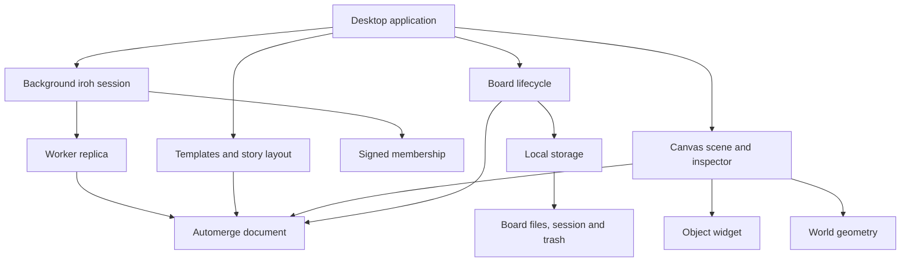

# Current architecture of Jotflock

This directory records the implemented architecture. Keep this overview and the
relevant numbered ADR current with every architecture-affecting change; record
future capabilities as planned rather than presenting them as implemented.

## Decisions

- [0001 — Native local-first desktop foundation](0001-native-local-first-foundation.md)
- [0002 — Canvas objects, frame membership and attached connectors](0002-canvas-object-foundation.md)
- [0003 — Core invariants and generated testing](0003-core-invariants-and-generated-testing.md)
- [0004 — Live-session availability](0004-live-session-availability.md)
- [0005 — Useful templates and structured story maps](0005-structured-templates.md)
- [0006 — Authenticated iroh sessions](0006-authenticated-iroh-sessions.md)
- [0007 — Home and canvas](0007-home-and-canvas.md)
- [0008 — Jotflock project identity](0008-jotflock-identity.md)

## Runtime and modules

`main.rs` owns the eframe application, board library, panels and save feedback.
`interface.rs` owns typography, icons, adaptive dialogs and board previews.
Board titles and object text can be edited in place. The drawing rail stays
visible and selection properties open on demand.
`workspace.rs` owns board open/close/create/delete lifecycle and session state.
`scene.rs` owns canvas interaction state, rendering order, selection and connection
creation. `card.rs` draws and interacts with an individual object. `geometry.rs`
contains GUI-independent world-space bounds, connector anchors and hit testing.
`document.rs` owns Automerge schema, read models and editing operations.
`storage.rs` owns filesystem persistence and recoverable board deletion.
`templates.rs` composes useful layouts; `story_map.rs` derives structured placement
from stable activity/release identities. `sharing.rs` owns signed membership and
invitations; `network.rs` owns the Tokio worker, authenticated iroh mesh and bounded
synchronization. `desktop.rs` owns single-instance forwarding and explicit Linux URL
registration.
`property_tests.rs` is compiled only for tests and exercises generated document,
replica and workspace sequences against the invariants in ADR 0003. Synthetic
compatibility bytes live in `tests/fixtures/`; failing-input seeds are retained in
`proptest-regressions/`.

## Persisted state

Each board is a schema-versioned Automerge file, with a `.bak` copy of its previous
saved version. A separate atomic `session.json` stores open board IDs and the active
board ID. The editor name is stored in `editor-name.txt`. Deleting a board archives its current file under `trash/`; closing saves
it and retains it in the library. `JOTFLOCK_DATA_DIR` overrides the data directory.
Object/connector IDs are stable; selection, pan, zoom, text focus and incomplete
connections remain local UI state. Schema 1 boards load into schema 2 with defaults;
unsupported versions fail explicitly. See ADR 0002 for migration and object rules.

## Accepted networking design

The first collaborative release will use live sessions: new participants need an
authorized online peer offering the board. Existing members can use saved replicas
offline and synchronize when connected again. No central board store or always-on
replica is planned for that release. Every admitted editor may invite and admit
new editors; the creator need not remain online. Join invitations expire after
24 hours; admitted members retain access, and any editor may issue a fresh link.
Signed membership, cached peer discovery, admission and expiry enforcement are
implemented in ADR 0006. Early invitation cancellation and member removal remain
future work. Presence is transient, with names/cursors/selections expiring after
three seconds of silence. See the ADR for trust assumptions and limitations.

## Boundaries and known limitations

Encrypted live sessions and structured templates are implemented. SQLite, background
board storage, undo/redo, multi-selection, general clipboard, nested frames, custom
styles, advanced connector routing/reattachment and axis deletion remain pending.
Board materialization and hit-testing are linear scans; the 5,000-object performance
target is unverified. Presence and network state are separate from durable board
content; saved local changes are not a claim of global durable delivery.

Automerge 0.12 is used for document state; Proptest 1.12 is a development-only test
dependency. The earlier dependency's no-op-edit/merge panic has a focused regression
test, and a file generated by version 0.7.4 checks backward compatibility.

Document creation/editing validates numeric inputs before mutation. Frame movement
preflights all member translations before writing. Load and filesystem save validate
live object geometry/text-object types. Connector operations enforce their object
kind, and the read model hides self-loops as well as invalid/deleted endpoints.
Failed pre-commit session writes during open/close restore local open/active state.
See ADR 0003 for exact scopes and the remaining filesystem transaction limitations.

Linux builds produce an AppImage using `package-appimage.sh`. Generated tests,
headless egui interaction tests, focused regressions, compatibility checks,
real multi-endpoint iroh tests, explicit relay-only verification, formatting,
Clippy and release packaging are the current checks. No formal proof
has been introduced. Live desktop and cross-distribution testing remain pending.
